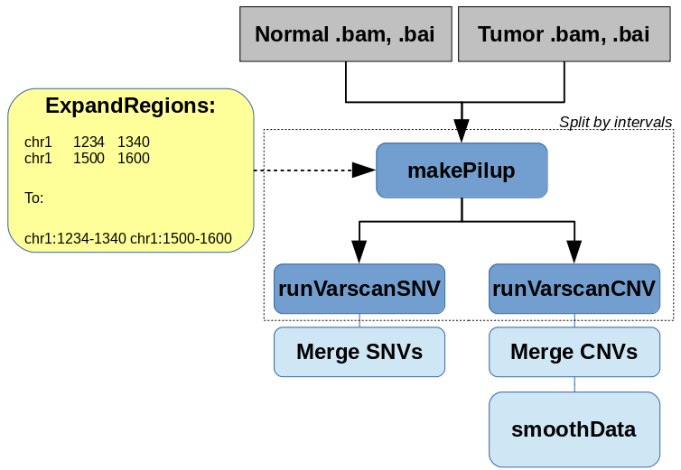

# varscan

## Overview

Varscan 2.3, workflow for calling somatic single nucleotide variations and indels, as well as copy number changes
Creation of mpileups and calling variants are done with parallel processing. Varscan uses original heuristic/statistical approach whish puts it apart of the other similar callers.



## Dependencies

* [picard 2.21.2](https://broadinstitute.github.io/picard)
* [varscan 2.4.2](http://varscan.sourceforge.net)
* [samtools 0.1.19](http://www.htslib.org/)
* [rstats 3.6](http://cran.utstat.utoronto.ca/src/base/R-3/R-3.6.1.tar.gz)
* [bcftools 1.9](https://github.com/samtools/bcftools)


## Usage

### Cromwell
```
java -jar cromwell.jar run varscan.wdl --inputs inputs.json
```

### Inputs

#### Required workflow parameters:
Parameter|Value|Description
---|---|---
`inputTumor`|File|input .bam file for tumor sample
`inputNormal`|File|input .bam file for normal sample
`inputTumorIndex`|File|input .bai file for tumor sample
`inputNormalIndex`|File|input .bai file for normal sample
`reference`|String|Reference assembly id, hg19 hg38 or mm10
`outputFileNamePrefix`|String|Output file(s) prefix


#### Optional workflow parameters:
Parameter|Value|Default|Description
---|---|---|---
`bedIntervalsPath`|String|""|Path to a .bed file used for splitting pileup job/limiting analysis to selected regions


#### Optional task parameters:
Parameter|Value|Default|Description
---|---|---|---
`expandRegions.modules`|String|"hg38-dac-exclusion/1.0"|required modules (This is to allow modularized data for bed path)
`expandRegions.jobMemory`|Int|4|Memory for this task in GB
`expandRegions.timeout`|Int|12|Timeout in hours, needed to override imposed limits
`getChrCoefficient.memory`|Int|1|Memory allocated for this job
`getChrCoefficient.timeout`|Int|1|Hours before task timeout
`makePileups.samtools`|String|"$SAMTOOLS_ROOT/bin/samtools"|path to samtools
`makePileups.jobMemory`|Int|18|memory for this job, in Gb
`makePileups.minMemory`|Int|6|Minimal amount of memory to assign to the task
`makePileups.timeout`|Int|40|Timeout in hours, needed to override imposed limits
`runVarscanCNV.pValue`|Float|0.05|p-value for cnv calling, default is 0.05
`runVarscanCNV.jobMemory`|Int|20|Memory in Gb for this job
`runVarscanCNV.minMemory`|Int|4|A minimum amount of memory allocated to the task, overrides the scaled RAM setting
`runVarscanCNV.javaMemory`|Int|6|Memory in Gb for Java
`runVarscanCNV.logFile`|String|"VARSCAN_CNV.log"|File for logging Varscan messages
`runVarscanCNV.varScan`|String|"$VARSCAN_ROOT/VarScan.jar"|path to varscan .jar file
`runVarscanCNV.modules`|String|"varscan/2.4.2 java/8"|Names and versions of modules
`runVarscanCNV.timeout`|Int|40|Timeout in hours, needed to override imposed limits
`getSnvNative.pValue`|Float|0.05|somatic p-value for SNV calling, default is 0.05
`getSnvNative.jobMemory`|Int|20|Memory in Gb for this job
`getSnvNative.minMemory`|Int|4|A minimum amount of memory allocated to the task, overrides the scaled RAM setting
`getSnvNative.javaMemory`|Int|6|Memory in Gb for Java
`getSnvNative.minCoverage`|Int|8|Minimum coverage in normal and tumor to call variant [8]
`getSnvNative.minCoverageNormal`|Int|8|Minimum coverage in normal to call somatic [8]
`getSnvNative.minCoverageTumor`|Int|6|Minimum coverage in tumor to call somatic [6]
`getSnvNative.minVarFreq`|Float|0.1|Minimum variant frequency to call a heterozygote [0.10]
`getSnvNative.minFreqForHom`|Float|0.75|Minimum frequency to call homozygote [0.75]
`getSnvNative.normalPurity`|Float|1.0|Estimated purity (non-tumor content) of normal sample [1.00]
`getSnvNative.tumorPurity`|Float|1.0|Estimated purity (tumor content) of normal sample [1.00]
`getSnvNative.pValueHet`|Float|0.99|p-value threshold to call a heterozygote [0.99]
`getSnvNative.strandFilter`|Int|0|If set to 1, removes variants with >90% strand bias
`getSnvNative.validation`|Int|0|If set to 1, outputs all compared positions even if non-variant
`getSnvNative.outputVcf`|Int|0|Flag that when set to 1 indicates that we need results in vcf format
`getSnvNative.logFile`|String|"VARSCAN_SNV.log"|File for logging Varscan messages
`getSnvNative.varScan`|String|"$VARSCAN_ROOT/VarScan.jar"|path to varscan .jar file
`getSnvNative.modules`|String|"varscan/2.4.2 java/8"|Names and versions of modules
`getSnvNative.timeout`|Int|40|Timeout in hours, needed to override imposed limits
`getSnvVcf.pValue`|Float|0.05|somatic p-value for SNV calling, default is 0.05
`getSnvVcf.jobMemory`|Int|20|Memory in Gb for this job
`getSnvVcf.minMemory`|Int|4|A minimum amount of memory allocated to the task, overrides the scaled RAM setting
`getSnvVcf.javaMemory`|Int|6|Memory in Gb for Java
`getSnvVcf.minCoverage`|Int|8|Minimum coverage in normal and tumor to call variant [8]
`getSnvVcf.minCoverageNormal`|Int|8|Minimum coverage in normal to call somatic [8]
`getSnvVcf.minCoverageTumor`|Int|6|Minimum coverage in tumor to call somatic [6]
`getSnvVcf.minVarFreq`|Float|0.1|Minimum variant frequency to call a heterozygote [0.10]
`getSnvVcf.minFreqForHom`|Float|0.75|Minimum frequency to call homozygote [0.75]
`getSnvVcf.normalPurity`|Float|1.0|Estimated purity (non-tumor content) of normal sample [1.00]
`getSnvVcf.tumorPurity`|Float|1.0|Estimated purity (tumor content) of normal sample [1.00]
`getSnvVcf.pValueHet`|Float|0.99|p-value threshold to call a heterozygote [0.99]
`getSnvVcf.strandFilter`|Int|0|If set to 1, removes variants with >90% strand bias
`getSnvVcf.validation`|Int|0|If set to 1, outputs all compared positions even if non-variant
`getSnvVcf.logFile`|String|"VARSCAN_SNV.log"|File for logging Varscan messages
`getSnvVcf.varScan`|String|"$VARSCAN_ROOT/VarScan.jar"|path to varscan .jar file
`getSnvVcf.modules`|String|"varscan/2.4.2 java/8"|Names and versions of modules
`getSnvVcf.timeout`|Int|40|Timeout in hours, needed to override imposed limits
`mergeCNV.jobMemory`|Int|6|memory in GB for this job
`mergeCNV.timeout`|Int|10|Timeout in hours, needed to override imposed limits
`mergeSNP.jobMemory`|Int|6|memory in GB for this job
`mergeSNP.timeout`|Int|10|Timeout in hours, needed to override imposed limits
`mergeIND.jobMemory`|Int|6|memory in GB for this job
`mergeIND.timeout`|Int|10|Timeout in hours, needed to override imposed limits
`mergeSNPvcf.jobMemory`|Int|12|memory in GB for this job
`mergeSNPvcf.javaMemory`|Int|8|memory in GB for java VM
`mergeSNPvcf.timeout`|Int|10|Timeout in hours, needed to override imposed limits
`mergeINDvcf.jobMemory`|Int|12|memory in GB for this job
`mergeINDvcf.javaMemory`|Int|8|memory in GB for java VM
`mergeINDvcf.timeout`|Int|10|Timeout in hours, needed to override imposed limits
`smoothData.varScan`|String|"$VARSCAN_ROOT/VarScan.jar"|Path to VarScan jar file
`smoothData.modules`|String|"varscan/2.4.2 java/8 rstats/3.6"|Modules for this job
`smoothData.min_coverage`|Int|20|Fine-tuning parameter for VarScan
`smoothData.max_homdel_coverage`|Int|5|Max coverage form homozygous deletion, default is 5
`smoothData.min_tumor_coverage`|Int|10|Min coverage in tumor sample, default is 10
`smoothData.del_threshold`|Float|0.25|Fine-tuning parameter for VarScan
`smoothData.amp_threshold`|Float|0.25|Amplification threshold to report, default is 0.25
`smoothData.min_region_size`|Int|10|Fine-tuning parameter for VarScan
`smoothData.recenter_up`|Int|0|Fine-tuning parameter for VarScan
`smoothData.recenter_down`|Int|0|Fine-tuning parameter for VarScan
`smoothData.jobMemory`|Int|16|Memory in Gb for this job
`smoothData.javaMemory`|Int|6|Memory in Gb for Java
`vcfCombine.modules`|String|"bcftools/1.9 tabix/1.9"|environment modules
`vcfCombine.jobMemory`|Int|16|Memory allocated for job
`vcfCombine.threads`|Int|4|Number of threads for processing
`vcfCombine.timeout`|Int|4|Hours before task timeout


### Outputs

Output | Type | Description | Labels
---|---|---|---
`resultCnvFile`|File?|file with CNV calls, smoothed|vidarr_label: resultCnvFile
`resultSnpFile`|File|file with SNPs, native varscan format|vidarr_label: resultSnpFile
`resultIndelFile`|File|file with Indel calls, native varscan format|vidarr_label: resultIndelFile
`resultSnpVcfFile`|File|file with SNPs, vcf format|vidarr_label: resultSnpVcfFile
`resultIndelVcfFile`|File|file with Indels, vcf format|vidarr_label: resultIndelVcfFile
`resultVcfFile`|File|file with snvs + indels, vcf format, bgzipped|vidarr_label: resultVcfFile
`resultVcfFileIndex`|File|index file for snv + indels vcf output|vidarr_label: resultVcfFileIndex


## Commands
This section lists command(s) run by varscan workflow

* Running varscan

```
	set -eo pipefail
	
	bgzip -c ~{vcfSnvs} > ~{outputFileNamePrefix}.varscan2_snv.vcf.gz
	tabix ~{outputFileNamePrefix}.varscan2_snv.vcf.gz
	bgzip -c ~{vcfIndels} > ~{outputFileNamePrefix}.varscan2_indel.vcf.gz
	tabix ~{outputFileNamePrefix}.varscan2_indel.vcf.gz
	bcftools concat -a -o ~{outputFileNamePrefix}.varscan2_all.vcf ~{outputFileNamePrefix}.varscan2_snv.vcf.gz ~{outputFileNamePrefix}.varscan2_indel.vcf.gz
	bgzip ~{outputFileNamePrefix}.varscan2_all.vcf
	tabix ~{outputFileNamePrefix}.varscan2_all.vcf.gz

```
```
    CHROM=$(echo ~{region} | sed 's/:.*//')
    grep -w SN:$CHROM ~{refDict} | cut -f 3 | sed 's/.*://' | awk '{print int(($1/~{largestChrom} + 0.1) * 10)/10}'
```
```
 python <<CODE
 import os
 if os.path.exists("~{bedPath}"):
    with open("~{bedPath}") as f:
        for line in f:
           line = line.rstrip()
           tmp = line.split("\t")
           r = " " + tmp[0] + ":" + tmp[1] + "-" + tmp[2]
           print(r)
    f.close()
 CODE
```
```
 set -euxo pipefail
 ~{samtools} mpileup -q 1 -r ~{region} -f ~{refFasta} ~{inputNormal} ~{inputTumor} | awk -F "\t" '$4 > 0 && $7 > 0' | gzip -c > normtumor_sorted.pileup.gz 
```
```
 set -euo pipefail
 head -n 1 ~{filePaths[0]} > "~{outputFile}.~{outputExtension}"
 cat ~{sep=' ' filePaths} | sort -V -k 1,2 | grep -v ^chrom | grep -v ^chrM >> "~{outputFile}.~{outputExtension}"
 cat ~{sep=' ' filePaths} | awk '{if($1 == "chrM"){print $0}}' | sort -V -k 1,2 >> "~{outputFile}.~{outputExtension}"
 if [ ! -s ~{outputFile}.~{outputExtension} ] ; then
  rm ~{outputFile}.~{outputExtension}
 fi
```
```
 set -euxo pipefail
 unset _JAVA_OPTIONS
 java -Xmx~{javaMemory}G -Djava.io.tmpdir="$TMP" -jar $PICARD_ROOT/picard.jar SortVcf I=~{sep=' I=' filePaths} SD=~{seqDictionary} O=~{outputFile}.~{outputSuffix}.vcf
```
```
 unset _JAVA_OPTIONS
 set -euxo pipefail
 python<<CODE
 import os
 import re
 varscan = os.path.expandvars("~{varScan}")
 varscanCommand = "zcat ~{inputPileup} | java -Xmx~{javaMemory}G -jar " + varscan + " somatic -mpileup 1 --somatic-p-value ~{pValue}"

 if "~{minCoverageNormal}" != "8":
    varscanCommand += " --min-coverage-normal ~{minCoverageNormal}"
 if "~{minCoverageTumor}" != "6":
    varscanCommand += " --min-coverage-tumor ~{minCoverageTumor}"
 if "~{minVarFreq}" != "0.1":
    varscanCommand += " --min-var-freq ~{minVarFreq}"
 if "~{minFreqForHom}" != "0.75":
    varscanCommand += " --min-freq-for-hom ~{minFreqForHom}"
 if "~{normalPurity}" != "1.0":
    varscanCommand += " --normal-purity ~{normalPurity}"
 if "~{tumorPurity}" != "1.0":
    varscanCommand += " --tumor-purity ~{tumorPurity}"
 if "~{pValueHet}" != "0.99":
    varscanCommand += " --p-value ~{pValueHet}"
 if "~{strandFilter}" != "0":
    varscanCommand += " --strand-filter 1"
 if "~{validation}" != "0":
    varscanCommand += " --validation 1"
 if "~{outputVcf}" != "0":
    varscanCommand += " --output-vcf 1"
    varscanCommand += " --output-snp ~{sampleID}.snp.vcf --output-indel ~{sampleID}.indel.vcf"
 else:
    varscanCommand += " --output-snp ~{sampleID}.snp --output-indel ~{sampleID}.indel"

 cvg = ~{minCoverage}
 resultsOk = False
 f = open("~{logFile}", "w+")
 f.write('[Varscan log]' + '\n')

 while not resultsOk:
     run_command = varscanCommand
     run_command += " --min-coverage " + str(cvg)
     cvg -= 2
     f.write('[' + run_command + ']\n')
     res_string = os.popen(run_command + " 2>&1").read()
     f.write(res_string)
     m = re.search(r'(\d+)', str(res_string))
     m = re.search(r'(\d+) had sufficient coverage', res_string)
     if not m or (m and m.group(1) == '0' and cvg <= 2):
         f.write('Unable to run Varscan even with min-coverage set to ' + str(cvg) + ' aborting...\n')
         break
     elif m and m.group(1) != '0':
         resultsOk = True
         f.write('Success!\n')
     else:
         f.write('Coverage threshold too high, trying min-coverage ' + str(cvg) + '...\n')

 if not resultsOk:
     f.write('Varscan failed\n')
 f.close()
 CODE
```
```
 unset _JAVA_OPTIONS
 set -euxo pipefail
 python<<CODE
 import os
 import re
 varscan = os.path.expandvars("~{varScan}")
 varscanCommand = "zcat ~{inputPileup} | java -Xmx~{javaMemory}G -jar " + varscan + " copynumber --output-file ~{sampleID} -mpileup 1 --p-value ~{pValue}"
 cvg = 0
 resultsOk = False
 f = open("~{logFile}", "w+")
 f.write('[Varscan log]' + '\n')

 while not resultsOk:
     run_command = varscanCommand
     if cvg == 0:
         cvg = 19
     cvg -= 4
     run_command += " --min-coverage " + str(cvg)
     f.write('[' + run_command + ']\n')
     res_string = os.popen(run_command + " 2>&1").read()
     m = re.search(r'(\d+)', str(res_string))
     m = re.search(r'(\d+) had sufficient coverage', res_string)
     if not m or (m and m.group(1) == '0' and cvg <= 2):
         f.write('Unable to run Varscan even with min-coverage set to ' + str(cvg) + ' aborting...\n')
         break
     elif m and m.group(1) != '0':
         resultsOk = True
         f.write('Success!\n')
     else:
         f.write('Coverage threshold too high, trying min-coverage ' + str(cvg) + '...\n')

 if not resultsOk:
     f.write('Varscan failed\n')
 f.close()
 CODE
```
```
 python<<CODE
 import os
 varscan = os.path.expandvars("~{varScan}")
 filterCommand = "java -Xmx~{javaMemory}G -jar " + varscan + " copyCaller ~{copyNumberFile} --output-file ~{sampleID}.copynumber.filtered"

 if "~{min_coverage}" != "20":
    filterCommand += " --min-coverage ~{min_coverage}"
 if "~{min_tumor_coverage}" != "10":
    filterCommand += " --min-tumor-coverage ~{min_tumor_coverage}"
 if "~{max_homdel_coverage}" != "5":
    filterCommand += "--max-homdel-coverage ~{max_homdel_coverage}"
 if "~{del_threshold}" != "0.25":
    filterCommand += " --del-threshold ~{del_threshold}"
 if "~{amp_threshold}" != "0.25":
    filterCommand += " --amp-threshold ~{amp_threshold}"
 if "~{min_region_size}" != "10":
    filterCommand += " --min-region-size ~{min_region_size}"
 if "~{recenter_up}" != "0":
    filterCommand += " --recenter-up ~{recenter_up}"
 if "~{recenter_down}" != "0":
    filterCommand += " --recenter-down ~{recenter_down}"

 message = os.popen(filterCommand + " 2>&1").read()
 CODE
```

## Support

For support, please file an issue on the [Github project](https://github.com/oicr-gsi) or send an email to gsi@oicr.on.ca .

_Generated with generate-markdown-readme (https://github.com/oicr-gsi/gsi-wdl-tools/)_
